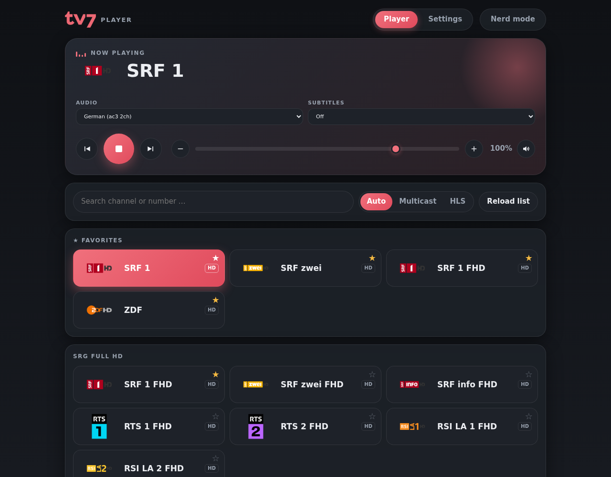
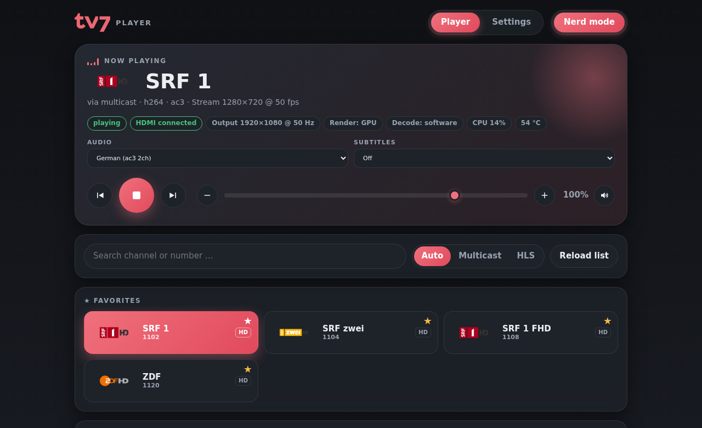
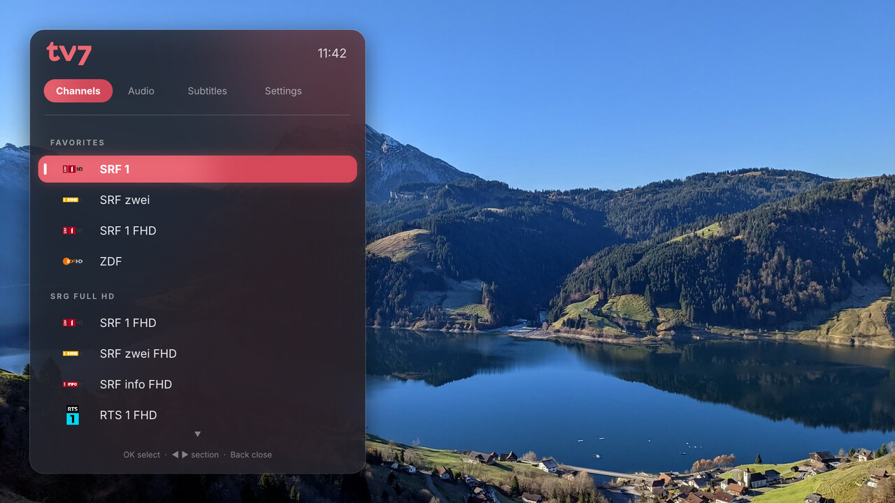
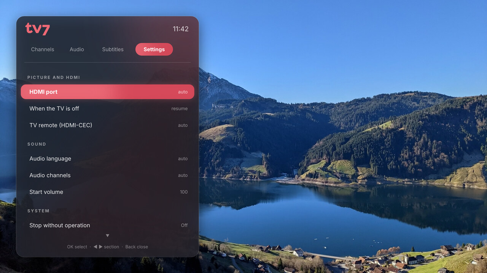
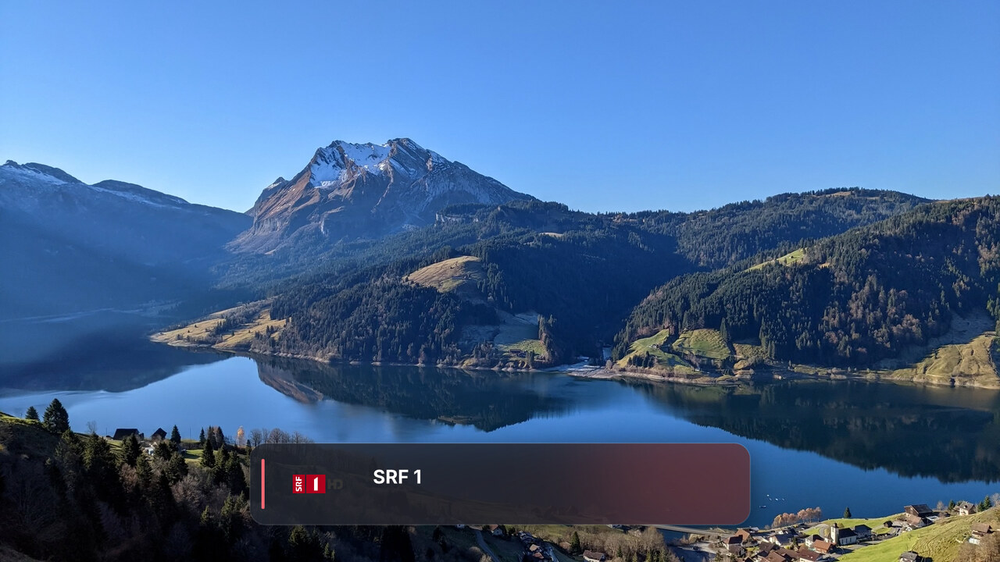
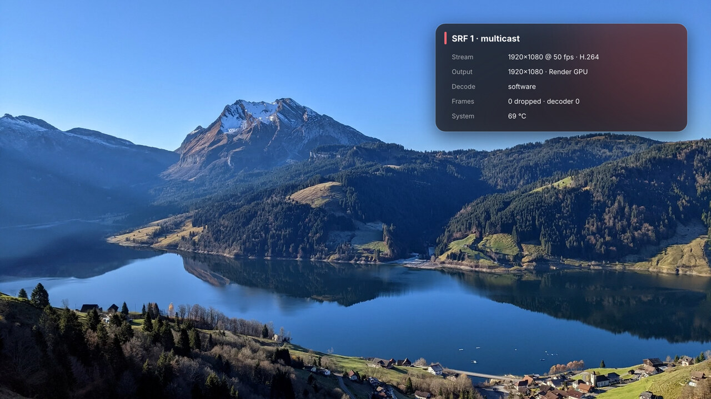

# Home Assistant App: TV7 Player

[![Version][version-shield]](tv7_player/CHANGELOG.md)
![Project Stage][project-stage-shield]
[![License][license-shield]](LICENSE.md)
[![Github Actions][github-actions-shield]][github-actions]

Watch Init7 TV7 and the SRG Full HD channels on the TV connected to your Home Assistant device.

## About

TV7 Player turns your Home Assistant device into a TV box. Connect it to your TV, projector or AV receiver with an HDMI cable and choose a channel:

- on the **TV7** page in the Home Assistant sidebar, with favorites and search,
- with the **remote control of your TV**, with a menu on the TV screen,
- or from **automations** and dashboards in Home Assistant.

The channel list comes directly from Init7, so new channels appear by themselves.

> TV7 is only available with an Init7 internet connection.

[:books: Read the full documentation][docs]

## Screenshots

The **TV7** page in Home Assistant:

| Player | Nerd mode |
| --- | --- |
|  |  |

On the TV, with the remote control:

| Channel menu | Settings menu |
| --- | --- |
|  |  |
| **Channel banner** | **Info on the TV** |
|  |  |

## Installation

[![Open the TV7 Player app in your Home Assistant][my-ha-shield]][my-ha]

1. Click the button above: it adds this repository to your Home Assistant and opens the app.
   Or by hand: Settings > Apps > App store > menu (⋮) > Repositories: add `https://github.com/SebiGo/tv7`.
2. Install **TV7 Player**, switch on **Show in sidebar** and start the app.
3. Connect your Home Assistant device to the TV, projector or AV receiver with an HDMI cable.
4. Choose a channel:
   - **TV remote:** switch the TV to that HDMI input and press **OK**.
   - **Player:** click **Open Web UI** on the app page (or **TV7** in the sidebar).

## Hardware

Recommended: a **Raspberry Pi 5** with Home Assistant OS. See [docs/HARDWARE.md](docs/HARDWARE.md) for other devices.

## Support

Problems or wishes? Open an [issue][issue]. On the TV7 page, **Settings > Copy support info** prepares the text for you (passwords and addresses are hidden).

## Contributing

See [contribution guidelines](.github/CONTRIBUTING.md) and [docs/DEVELOPMENT.md](docs/DEVELOPMENT.md).

## License

MIT, see [LICENSE.md](LICENSE.md). The TV7 name and logo belong to Init7 (Schweiz) AG and are excluded.

[docs]: https://github.com/SebiGo/tv7/blob/main/tv7_player/DOCS.md
[github-actions-shield]: https://github.com/SebiGo/tv7/actions/workflows/ci.yaml/badge.svg?branch=main
[github-actions]: https://github.com/SebiGo/tv7/actions
[issue]: https://github.com/SebiGo/tv7/issues
[my-ha]: https://my.home-assistant.io/redirect/supervisor_addon/?addon=7a416ca0_tv7_player&repository_url=https%3A%2F%2Fgithub.com%2FSebiGo%2Ftv7
[my-ha-shield]: https://my.home-assistant.io/badges/supervisor_addon.svg
[license-shield]: https://img.shields.io/github/license/SebiGo/tv7.svg
[project-stage-shield]: https://img.shields.io/badge/project%20stage-production%20ready-brightgreen.svg
[version-shield]: https://img.shields.io/badge/dynamic/yaml?url=https%3A%2F%2Fraw.githubusercontent.com%2FSebiGo%2Ftv7%2Fmain%2Ftv7_player%2Fconfig.yaml&query=%24.version&label=version
