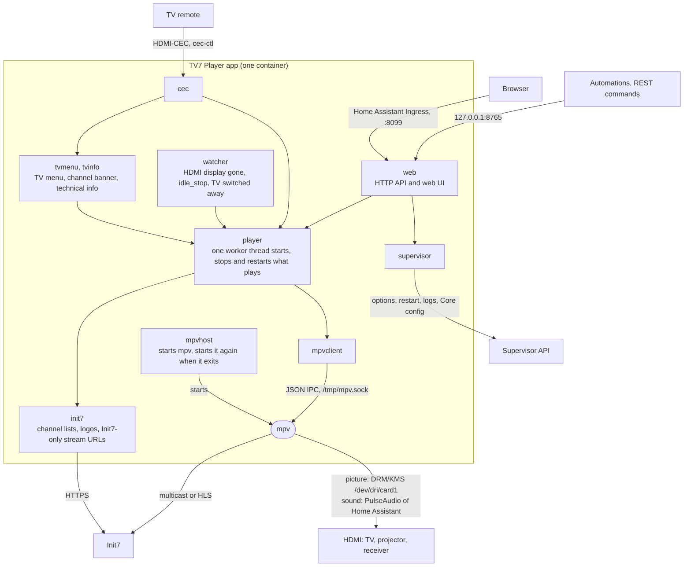
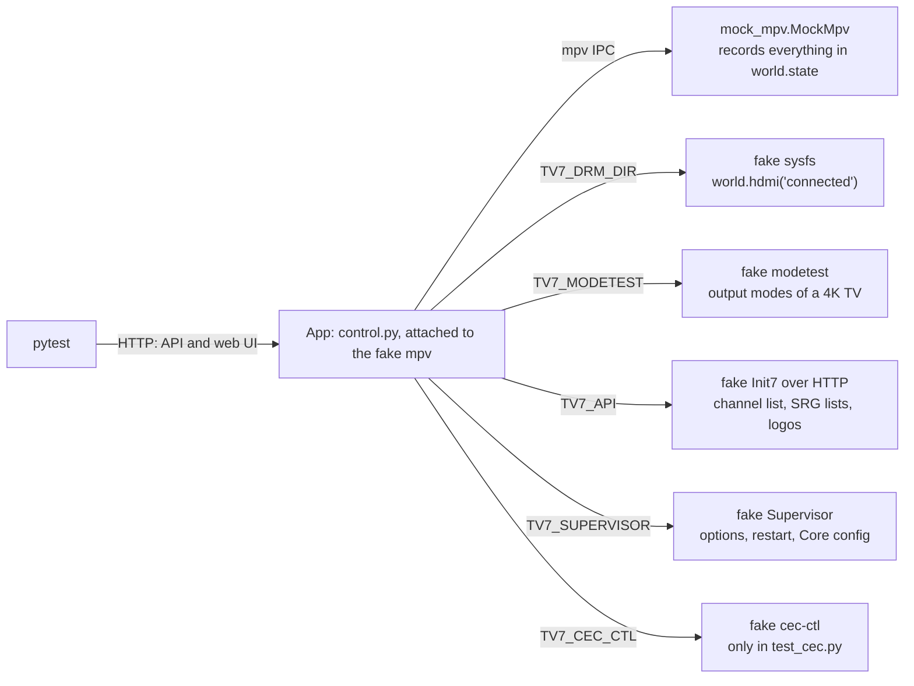

# Development

Open the folder in VS Code and run **Dev Containers: Reopen in Container**. Two configurations are offered:

| Configuration | For | Needs |
|---|---|---|
| **TV7 Player (web)** | web UI, HTTP API, tests, shell scripts | Docker only |
| **TV7 Player (hardware)** | real HDMI and audio output | Linux host with `/dev/dri`, `/dev/snd`; ideally the Pi itself (VS Code Remote-SSH to the Pi, then reopen in the container) |

## Web server (no hardware)
```
dev/run-web.sh                       # web UI + API against a fake mpv: http://localhost:8099 (forwarded), live reload
cd tv7_player && python3 -m pytest          # all tests, offline (about 2 minutes); -k <name> runs a part, --live the real Init7 list
ruff check . && ruff format --check .        # Python lint and format (ruff.toml, 120 columns, also comments); `ruff format .` formats
yamllint -c .yamllint tv7_player .github repository.yaml   # YAML lint
shellcheck tv7_player/rootfs/*.sh tv7_player/pi-debs.sh dev/*.sh
```
The devcontainer image has pytest, ruff, yamllint and shellcheck. With `dev/run-web.sh` the channel list comes from Init7's public API; "playing" a channel only happens in the fake mpv `tv7_player/tests/mock_mpv.py`, which the tests use as well.

## Tests
- `tests/fakes.py` builds the fake world once per test run: Init7 channel list and logos, the Supervisor, HDMI in sysfs, `modetest` and mpv (`mock_mpv.py`). `App` starts `control.py` against it on free ports.
- `tests/conftest.py` has the fixtures: `world` (the fake world), `app` (the main instance with the web UI), `start_app(...)` (more instances with their own environment, e.g. other options or shorter timers; stopped after the test).
- The files are grouped by topic: `test_playback` (channel start, sources, tracks, `/events`), `test_output_mode`, `test_channels` (SRG Full HD, logos), `test_web_ui` (page, settings, favorites), `test_tv_menu`, `test_diagnostics` (`/nerd`, `/support`), `test_autostop` (HDMI watcher, `idle_stop`), `test_cec`, `test_display` and `test_player` (functions of `tv7/` called directly), `test_files` (config.yaml, translations and texts agree), `test_layers` (imports follow the layers).
- `tv7/config.py` reads every `TV7_*` environment variable (paths, addresses, times), so the tests and `dev/run-web.sh` can point the app at fakes and shorten its timers. No other module reads the environment (`test_layers.py` checks that); in production none of them is set.

**Live reload:** `dev/run-web.sh` sets `TV7_DEV_RELOAD=1`. The version in `/status` then carries the modification time of `ui.html`, the logo, the translations, the texts and the program (`control.py`, `tv7/*.py`), and the open page reloads itself within about 2.5 s after a change (the same mechanism that reloads the page after an app update). When `control.py`, `tv7_player/tests/mock_mpv.py` or a text file in `i18n/` changes, the script restarts both. Only one instance can run (ports 8099 and 8765); stop an old one with Ctrl+C first.

## Video output: what is possible
- The output goes straight to the **DRM/KMS** display (no X11/Wayland). That needs the display exclusively, so it cannot run on a desktop that is showing a graphical session. On a desktop PC: switch to a text console (Ctrl+Alt+F3) and run `/run.sh` in the hardware container, or use a separate GPU/connector (`hdmi_port`).
- Windows/macOS Docker Desktop and WSL2: **no** DRM access; use the web configuration only.
- The Raspberry-specific parts (H.265 hardware decoder, overlay planes, `drm-device` selection) only work on a real Raspberry Pi. On a PC the app falls back to software decoding and the GPU/DRM output of the PC's driver; sound goes through ALSA.
- Practical workflow: develop in the web container, then test the real output on the Pi (copy `tv7_player` to `/local_apps` on Home Assistant OS and update the app, or the hardware devcontainer over Remote-SSH on a Pi).

## Architecture
The diagrams are Mermaid: GitHub shows them as graphics; in VS Code a Markdown preview with Mermaid support does.

One process (`control.py`) controls one mpv, which draws straight onto the HDMI display. Every arrow is a call or a request in the direction of the arrow.

The tests replace everything outside the app with fakes (`tests/fakes.py`) and start the real `control.py` against them:


## Modules and layers
The modules of `tv7/` sit in layers. A module imports only modules of the layers below it; `tests/test_layers.py` checks
that. Where a lower module has to tell an upper one something (a key from the TV remote, playback ended), it calls a hook
that `control.py` fills at start.
| Layer | Modules | What they do |
|---|---|---|
| 8 | `web` | HTTP API and web UI: endpoints, `/events` |
| 7 | `tvmenu`, `support` | TV menu, channel banner, remote keys; support text |
| 6 | `tvinfo` | technical info on the TV picture |
| 5 | `system`, `tvdraw` | live data for the views; drawing on the TV (shapes, texts, language, logos) |
| 4 | `player`, `mpvhost` | what plays and why it stopped; starting and supervising mpv |
| 3 | `settings` | options: read, validate, save, apply live |
| 2 | `display`, `cec` | HDMI/DRM ports, modes, planes; the HDMI-CEC bus |
| 1 | `init7`, `supervisor`, `mpvclient` | Init7 channel lists; Supervisor API; mpv IPC |
| 0 | `config`, `png`, `hwdec` | paths, times, texts, log; PNG decoder; hardware decoder per device |
Hooks (set in `control.py`):

| Hook | Set to | When |
|---|---|---|
| `cec.handlers["key"]` | `tvmenu.handle_key` | a key of the TV remote |
| `cec.handlers["standby"]` | `player.tv_standby` | the TV switched to standby |
| `cec.handlers["shown"]` | `player.tv_shown` | the TV switched to a source (the app's or another) |
| `cec.handlers["playing"]` | reads `player.state` | the TV asks who the active source is |
| `player.handlers["resume"]` | `tvmenu.resume` | start again after the TV came back, with the channel banner |
| `mpvclient.on_idle` | `tvinfo.playback_ended` | playback ended: remove the technical info at once |
| `tvdraw.on_logo_ready` | `tvmenu.logo_ready` | a channel logo is converted: draw the menu or banner again |

**Playback state:** `player.state` holds what plays, the last start (support text), the last channel (play key) and the
notes of automatic stops. Only `player` changes it; everything else reads it. Every change of what plays goes through
`player.player(...)`, one worker thread, so the web UI, the TV menu, CEC and the watcher never overlap. `player.play()` is
a start someone asked for; it clears the notes of automatic stops and keeps the result for the support text.

## Layout
- `tv7_player/rootfs/control.py` the start (production: starts and supervises mpv; with `<socket> <port>` it attaches to an mpv started by someone else: tests, `dev/run-web.sh`). The code is in the package `tv7_player/rootfs/tv7/` (layers above): `config` (version, paths, texts), `init7` (channel lists, Init7-only stream addresses, logos, favorites), `supervisor` (Supervisor API: options, restart, log, versions, Core config), `mpvclient` (mpv IPC, log, change notifications), `png` (PNG decoder for the logos), `hwdec` (hardware decoder per device), `display` (HDMI, modes, planes, deinterlacing), `cec` (HDMI-CEC bus), `settings` (options), `player` (channel start/stop on one worker thread, output mode that follows the stream, automatic stops and resumes), `mpvhost` (starting and supervising mpv, audio device), `system` (load, audio devices, nerd data), `tvdraw` (drawing on the TV, language of the TV texts, logo cache), `tvinfo` (technical info on the TV), `tvmenu` (menu, banner, remote keys), `support` (support text), `web` (API, web UI, `/events`).
- `tv7/web.py` has one function per endpoint and the routing tables `GET` (API and web UI), `UI_POST` and `UI_STATIC` (web UI only). A new endpoint is a function plus one entry there; errors become answers in one place (`KeyError` 404, `ValueError` 400, `PermissionError` 403, anything else 502).
- `tv7_player/rootfs/ui.html` the page; `tv7_player/rootfs/i18n/<lang>.json` its texts ("ui") and those of the TV menu, banner and technical info ("tv"), de/en/fr/it; `tv7_player/translations/<lang>.yaml` the option names and descriptions (Home Assistant's format, also used by the web UI).
- `tv7_player/rootfs/run.sh` only starts `control.py`.
- `tv7_player/` is the Home Assistant app (`config.yaml`, `Dockerfile`, DOCS, translations); `repository.yaml` makes the folder an add-on repository.
- Code, comments and log messages are English; only UI text is translated.

## Threads
`control.py` starts these threads; everything else runs inside them.
- **HTTP servers:** the API (127.0.0.1) and the web UI (Ingress), one thread per request; `/events` keeps its thread while the page is open.
- **Player worker** (`player.player`): the only thread that starts, stops or restarts what plays. Web UI, TV menu, CEC and the watcher hand their actions to it, so they never overlap.
- **Watcher** (`player.watcher`): every 2 s checks the HDMI display, inactivity (`idle_stop`) and whether the TV switched away (CEC).
- **TV overlay** (`tvmenu.osd_loop`): refreshes the technical info and closes the menu and banner after their time; `tvdraw.ha_language_loop` follows Home Assistant's language for the TV texts.
- **CEC** (`cec.cec_setup`): registers the app on the HDMI-CEC bus, then reads the TV's messages (`cec-ctl -W`) and passes them to `cec.handlers`.
- **mpv log reader** (`mpvclient.mpv_log`): collects mpv's log for nerd mode and the support text.
- **mpv supervision** (`mpvhost.run_player`, the main thread): starts mpv and starts it again when it exits.
